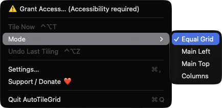
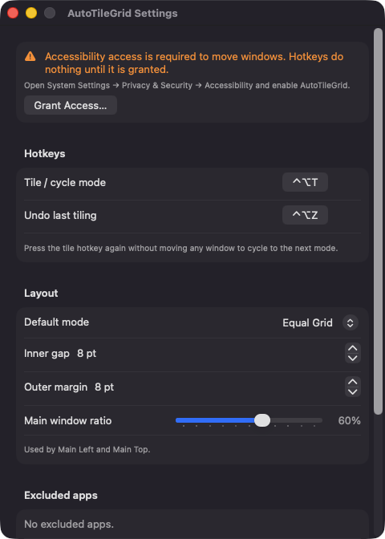

# AutoTileGrid

**🌐 Website:** [turhe123.github.io/auto-tile-grid](https://turhe123.github.io/auto-tile-grid/)

**One hotkey tiles all visible windows on a screen into a tidy grid, with layout cycling.**

> 🆓 A free, open-source **Mosaic alternative** for macOS 14+. Native Swift, no accounts, no subscriptions, MIT licensed.


## Why

AutoTileGrid is a free, open-source, 100% native, backend-free alternative to paid utilities in the *Window Management* category. It was inspired by Mosaic ($14.99 one-time) and focuses on one job: instantly arranging the windows on your current screen, without learning a full tiling window manager. No accounts, no network access, no telemetry.

## Features

- **Global tile hotkey** (default `⌃⌥T`) tiles all standard, non-minimized, non-fullscreen windows on the screen under the mouse.
- **Four layout modes:** Equal Grid, Main Left (main window plus a stack on the right), Main Top (main window plus a row below) and Columns.
- **Layout cycling:** press the tile hotkey again, without moving any window, to jump to the next mode.
- **Undo hotkey** (default `⌃⌥Z`) restores the frames of all windows touched by the last tiling.
- **Configurable spacing:** inner gap (0–64 pt), outer margin (0–128 pt) and main-window ratio (30–80%) for the two main modes.
- **Excluded apps:** pick apps in Settings that should never be tiled.
- **Rebindable hotkeys** with a click-to-record field.
- **Menu bar app** with a grid icon: Tile Now, Mode submenu with checkmarks, Undo Last Tiling, Settings, Support and Quit.
- **On-screen label** naming the applied mode, shown briefly at the center of the screen. With fewer than two eligible windows it shows "Nothing to tile".
- **Stable placement:** windows are ordered by their current top-left position, so they don't jump around between runs.
- **Large window counts:** above 16 windows every mode falls back to the equal grid with smaller cells, and the label says so.
- **Whole-point rectangles** for crisp edges; windows with a minimum size larger than their cell keep it and overlap instead of looping.
- **Launch at login** toggle.

## Screenshots

<p align="center"></p>

<p align="center"><em>The AutoTileGrid menu bar menu with the Mode submenu open, where you pick Equal Grid, Main Left, Main Top or Columns next to Tile Now and Undo Last Tiling.</em></p>

<p align="center"></p>

<p align="center"><em>The Settings window, with rebindable tile and undo hotkeys, default layout mode, inner gap, outer margin and main window ratio.</em></p>

## Install

1. Download `AutoTileGrid-macOS.zip` from the [latest release](https://github.com/turhe123/auto-tile-grid/releases/latest).
2. Unzip it and move `AutoTileGrid.app` to `/Applications`.
3. Because the app is open source and not notarized, clear the quarantine flag:

   ```bash
   xattr -cr /Applications/AutoTileGrid.app
   ```

4. Right-click the app and choose **Open** the first time you launch it.

## Build from source

Requires macOS 14+ and Xcode with Swift 5.9+.

```bash
brew install xcodegen
xcodegen generate
xcodebuild -project AutoTileGrid.xcodeproj -scheme AutoTileGrid -configuration Release -derivedDataPath ./build build
```

The app is produced at `build/Build/Products/Release/AutoTileGrid.app`.

## Permissions

- **Accessibility (required).** Used to list other apps' windows and to read and set their position and size. Without it, the hotkeys do nothing and the menu shows a "Grant Access…" row. Enable it under System Settings → Privacy & Security → Accessibility.

AutoTileGrid does **not** request Screen Recording or Microphone access, and the code contains no code that uses them. It makes no network connections; the only outbound action is opening the Ko-fi page in your browser when you click the Support button.

## Support ❤️

If AutoTileGrid saves you time, you can support its development:

[Support Or (Leo) Davidai ❤️](https://ko-fi.com/leodavidai)

## More free Mac apps

AutoTileGrid is one of [60 free, open-source Mac utilities](https://github.com/turhe123/mac-apps) built the same way: native Swift, no accounts, no telemetry. Browse the full gallery at [turhe123.github.io/mac-apps](https://turhe123.github.io/mac-apps/).

## License

MIT © Or Davidai Bachar
